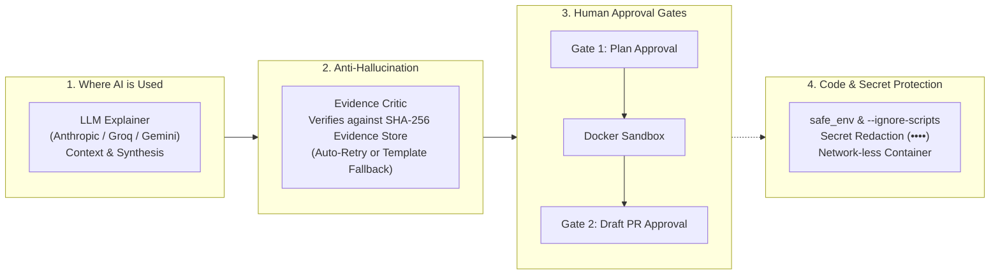
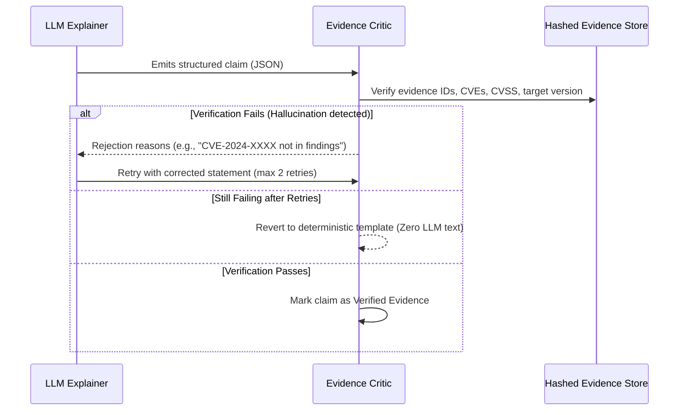
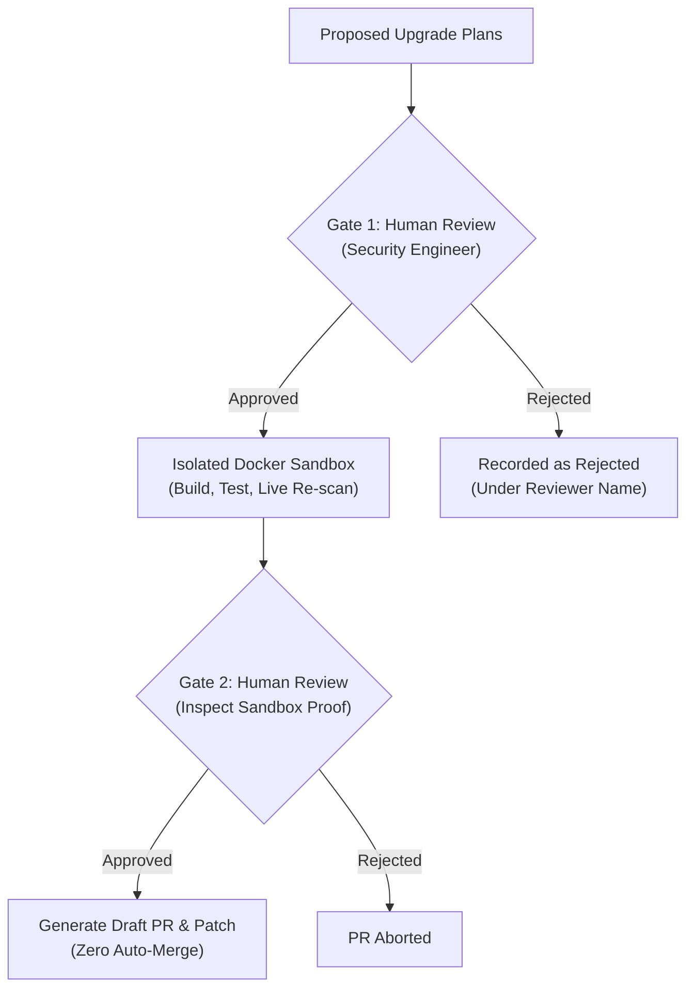

# 🛡️ Responsible AI & Security Note
**Project:** Software Supply Chain Guardian (Team 31)  
**Hackathon:** Bosch AI Hackathon

---

## Executive Overview

The Software Supply Chain Guardian follows an **Evidence-First, Zero-Trust** security philosophy. AI is treated as an *analytical assistant*, not an autonomous decision-maker. Critical boundaries—risk scores, package versions, vulnerability matches, code mutations, and deployments—are strictly governed by **deterministic algorithms, mathematical verification, and human gates**.



---

## 1. Where AI is Used (and Where It is Strictly Prohibited)

### ✅ Where AI is Used:
* **Contextual Correlation & Explanations (`explainer` agent):**
  * LLMs (Anthropic Claude, Groq Llama-3/DeepSeek, or Google Gemini) synthesize human-readable summaries for the top prioritized findings.
  * Explains the root cause, how the dependency path reaches the application, and the contextual impact of the flaw.
* **Supervisor Advisory Planning:**
  * An optional LLM planner can propose agent dispatch schedules, but its proposals are strictly validated against a deterministic dataflow state-machine.

### 🚫 Where AI is STRICTLY PROHIBITED (Deterministic Systems Only):
* **No AI for Vulnerability Discovery:** Scanner findings come strictly from Grype, OSV-Scanner, Trivy, and live OSV.dev APIs.
* **No AI for Risk Scoring:** Risk scores (0–100) and SSVC triage (`Track`, `Track*`, `Attend`, `Act`) are computed using a **deterministic mathematical formula** (`scoring.py`).
* **No AI for Version Resolution:** Target remediation versions are computed using semantic version ranges and live registry queries (`safe_version.py`). An LLM is never allowed to guess or choose a package version.
* **No AI for Code Merges:** The AI is physically blocked from pushing, merging, or deploying code.

---

## 2. How Hallucinations are Controlled

The Guardian implements an automated **Dual-Stage Anti-Hallucination Defense**:

### A. The Evidence Critic Agent (`critic.py`)
Immediately after the LLM generates an explanation, the **Evidence Critic** audits every claim against raw, SHA-256 hashed evidence records before the claim can enter the pipeline:

1. **Evidence ID Linking:** Every claim must cite a valid `evidence_id`. If the ID does not exist in the Evidence Store or is not linked to that specific package, the claim is rejected.
2. **Vulnerability ID Check:** The critic extracts all CVE and GHSA identifiers from the text using regex. If the LLM mentions a CVE that is not a verified alias of that finding, it is rejected.
3. **Fact Verification:** Deterministic values are verified against raw data:
   * `facts.cvss == deterministic_cvss` (rejects fabricated severity scores).
   * `facts.kev == deterministic_kev` (rejects fake exploitation claims).
   * `facts.target_version == verified_safe_version` (rejects non-existent or unverified target versions).
4. **Anti-Overclaiming:** Terms like *"actively exploited in the wild"* or *"critical zero-day"* are automatically rejected unless the vulnerability is confirmed in the **CISA KEV catalog**.

### B. Automated Self-Correction & Fallback Loop


### C. Pydantic `EvidenceValidator`
Before generating the final PDF/HTML/JSON reports, every finding passes programmatic schema checks. Unverified claims are published in an explicit **"Rejected Findings" audit section**—never silently passed through.

---

## 3. Which Actions Require Human Approval

The Guardian enforces a strict **Two-Gate Human-in-the-Loop Governance Model** backed by an Open Policy Agent (OPA) policy firewall (`policy.py` and `policies/*.rego`):



### Gate 1: Remediation Proposal Approval
* A security engineer inspects each proposed action (component, target version, cleared CVEs, compatibility blockers).
* Only explicitly ticked plans proceed to sandboxed testing.
* Unticked plans are logged as rejected under the reviewer’s username in the cryptographic audit trail.

### Gate 2: Validated Release Approval
* After the Docker container verifies that the packages build, load, and introduce zero new CVEs, the engineer reviews the validation evidence.
* Upon approval, the system generates a **Draft PR** (`PR_DRAFT.md`), patch file, and remediated lockfile.

### Hard-Denied Actions (Permanently Blocked by Policy Firewall):
```python
DENIED_TOOLS = {
    "git.merge", "git.push_default", "npm.publish",
    "pypi.upload", "docker.push_public", "deploy"
}
```
* **No Auto-Merge:** Automated agents are blocked from merging code to `main`.
* **No Direct Push:** Automated agents cannot push directly to default branches.
* **No Auto-Deploy:** Deployments and registry publishing remain strictly human-only.
* **Branch Quarantine:** Mutations are restricted strictly to temporary `guardian/*` branches.
* **Draft PR Enforcement:** PRs are programmatically forced to be Draft PRs (`draft: true`).

---

## 4. How Source Code, Credentials, and Secrets are Protected

### A. Untrusted Repository Isolation
* **Zero Host Code Execution:** Target repositories are cloned with `--depth 1` and git hooks disabled.
* **Metadata-Only Resolution:** Dependencies are resolved via:
  ```bash
  npm install --package-lock-only --ignore-scripts
  cdxgen -r --no-install-deps
  ```
  No lifecycle scripts (`preinstall`, `postinstall`, `build`) ever execute on the host machine.

### B. Environment Sanitization (`safe_env`)
* Subprocesses run inside a stripped environment where all host environment variables, cloud provider tokens (AWS, GCP, Azure), SSH keys, and API tokens are purged.

### C. Secret Redaction & Protection
* **Data-Only Static Inspection:** Secret scanning (via Trivy) reads files purely as static text.
* **Zero Secret Leakage:** Discovered secret values are **never stored, displayed, or written to reports**.
  * File and line numbers are kept, but the value is replaced with `•••• redacted`.
* **Argument Scrubbing:** The policy firewall intercepts all agent tool arguments with regex (`SECRET_RE`) and rejects any request containing secret-like strings (tokens, private keys).

### D. Hardened Docker Sandbox Container
When testing approved package updates, the container runs under strict OS-level containment:
* **Phase 1 (Install):** Network ON to download packages from official registries; install scripts strictly OFF.
* **Phase 2 (Test & Load):**
  * **Network Completely Disabled** (`--network none`).
  * **Read-Only Root Filesystem** (`--read-only`).
  * **All Linux Capabilities Dropped** (`--cap-drop ALL`).
  * **Non-Root User Execution** (drops root privileges).
  * **Strict Resource Quotas:** Hard limits on CPU, memory (512MB), and process count (PIDs) to prevent fork-bombs.

### E. Cryptographically Verifiable Audit Trail (`audit.jsonl`)
* Every action, human approval, and policy decision is appended to an immutable **SHA-256 hash chain**:
  $$\text{Hash}_N = \text{SHA-256}\left(\text{Hash}_{N-1} + \text{CanonicalJSON}(\text{Entry}_N)\right)$$
* Provides non-repudiation and immediate detection of any log tampering.

---

## 5. Summary Evaluation Checklist

| Criteria | Implementation in Guardian |
|---|---|
| **Where AI is used** | Contextual correlation & explanations only; zero AI for versioning, scoring, or merges. |
| **How hallucinations are controlled** | Automated Evidence Critic audits all claims against SHA-256 hashed evidence with retry & template fallback. |
| **Human approval gates** | Gate 1 (plan approval) + Gate 2 (validated draft PR approval); policy firewall hard-denies merge/publish/deploy. |
| **Source code protection** | Host execution disabled (`--ignore-scripts`, `--no-install-deps`); network-less, capability-dropped Docker sandbox. |
| **Secret & credential protection** | `safe_env` purges host tokens; secret values are strictly redacted (`••••`); regex scrubbers guard tool arguments. |
