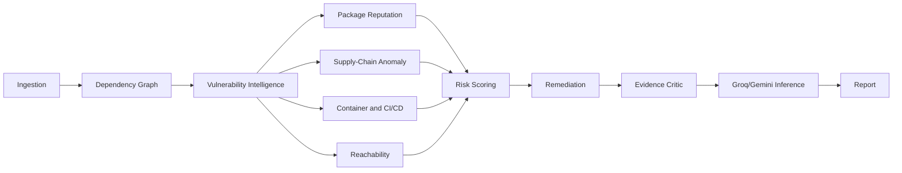

# Software Supply Chain Guardian - Agent Architecture

## 1. Overview

The Guardian is implemented as a 12-node LangGraph state machine. It processes
SBOM, dependency graph, lockfile, scanner, source, container, and CI/CD inputs
into a prioritized, evidence-backed security report.

The pipeline uses deterministic tools for parsing, package matching, scoring,
version selection, evidence hashing, and report generation. LLMs are used only
for correlation and explanatory analysis. Groq is the primary provider and
Gemini is the fallback.

## 2. Architecture Diagram



## 3. Shared State

Every node receives and returns a `GuardianState` containing:

- `run_id`: unique pipeline run identifier.
- `inputs`: SBOM, graph, scanner, manifest, source, or container paths.
- `components`: package inventory keyed by PURL.
- `edges`: dependency relationships.
- `findings`: vulnerability, anomaly, reachability, CI/CD, and container findings.
- `evidence`: hashed evidence records keyed by evidence ID.
- `coverage`: source availability and stage completion status.
- `remediation_plans`: proposed actions that require human approval.
- `approvals`: LLM analyses and approval records.

LangGraph invokes nodes with dictionary state updates and the supervisor
reconstructs the dataclass state between nodes.

## 4. Agent Roster

### 4.1 Ingestion

**Responsibility:** normalize supported inputs.

- Parses CycloneDX 1.x SBOM JSON.
- Parses Graph JSON nodes and edges.
- Parses UTF-8 and UTF-16 JSON scanner reports.
- Parses requirements-style package manifests.
- Detects Grype reports by their `matches` structure rather than filename.
- Tracks missing files, malformed JSON, unsupported JSON, and partial input
  coverage.

**Output:** normalized components, direct-package flags, sources, and graph
data.

### 4.2 Dependency Graph Builder

**Responsibility:** preserve and complete dependency relationships.

- Maps graph roots to direct dependencies.
- Converts graph edges into `Edge` records.
- Merges relationships with SBOM components.
- Tracks graph coverage.

**Output:** components and dependency edges suitable for path analysis.

### 4.3 Vulnerability Intelligence

**Responsibility:** collect deterministic vulnerability findings.

- Detects Grype reports by JSON structure.
- Creates one finding per advisory and exact package version.
- Extracts severity, CVSS base score, fixed versions, and PURL.
- Stores scanner records in the evidence store.
- Queries OSV.dev in batch for additional advisory coverage.
- Extracts CVEs from Grype CVE URLs and related vulnerability fields.
- Queries FIRST EPSS for exploitation probability scores.

**Output:** vulnerability findings and evidence IDs.

**Deterministic rule:** version matching, CVE extraction, fixed-version selection,
and CVSS values are not decided by the LLM.

### 4.4 Package Reputation

**Responsibility:** collect package registry reputation evidence.

- Uses npm packument metadata for npm components.
- Uses PyPI JSON metadata for Python components.
- Runs registry requests concurrently with a bounded worker pool.
- Filters invalid component names before network access.
- Records successful API responses as hashed evidence.

**Output:** package metadata and registry evidence.

### 4.5 Supply-Chain Anomaly

**Responsibility:** identify non-CVE supply-chain indicators.

- Detects package install-script declarations.
- Reviews lockfile integrity and resolved URL indicators.
- Checks package names for limited typosquat-like patterns.
- Stores detector output as evidence.
- Produces anomaly findings only for supported deterministic checks.

**Output:** supply-chain anomaly findings and evidence references.

### 4.6 Container and CI/CD

**Responsibility:** inspect container and automation configuration.

- Detects unpinned Docker `FROM` images.
- Detects tag-based GitHub Actions.
- Detects dangerous workflow combinations such as
  `pull_request_target` plus broad permissions.
- Creates image or CI findings for detected conditions.

**Output:** container and CI/CD findings.

### 4.7 Reachability

**Responsibility:** determine whether imported packages are referenced by source.

- Uses Python AST import analysis.
- Uses regular-expression import/require checks for JavaScript and TypeScript.
- Stores source evidence as hashed tool output.
- Labels reachability as Medium confidence unless stronger call analysis exists.

**Output:** reachability findings linked to exact components.

### 4.8 Risk Scoring

**Responsibility:** rank findings with explainable deterministic multipliers.

- Uses CVSS base score or a calibrated base for non-CVSS findings.
- Applies reachability evidence when it matches the finding component.
- Applies scope multipliers for development, test, and build components.
- Records the score breakdown in the finding.

**Output:** ranked findings with score components.

### 4.9 Remediation

**Responsibility:** create proposed remediation actions.

- Creates `request_review` plans for open findings.
- Sets `merge=false`.
- Marks every plan as requiring human approval.
- Never writes code, opens a PR, merges, or applies changes automatically.

**Output:** human-gated remediation plans.

### 4.10 Evidence Critic

**Responsibility:** validate evidence references.

- Rejects findings that reference missing evidence IDs.
- Raises evidence-backed findings to High confidence.
- Records downgraded or rejected findings for review.

**Output:** confidence and finding status validation.

### 4.11 Groq/Gemini Inference

**Responsibility:** correlate verified findings and explain actions.

- Groq is attempted first.
- Gemini is attempted automatically if Groq is not configured or fails.
- Requests JSON-only structured responses.
- Converts JSON arrays to a structured `findings` object.
- Stores provider, model, and analysis in approval records.
- Returns explicit coverage status for missing keys, provider errors, and invalid
  JSON.

**Output:** inference-labelled correlation, never an automatic remediation.

**Safety rule:** LLM output never changes deterministic version, score, CVSS,
fixed-version, or evidence values.

### 4.12 Report

**Responsibility:** serialize verified pipeline results.

- Guardian JSON report.
- SARIF 2.1.0 report.
- CycloneDX-style VEX report.
- Markdown or HTML report support may be added at higher output layers.

**Output:** machine-readable and human-readable deliverables.

## 5. LangGraph Execution

LangGraph execution is compiled during `Supervisor` initialization:

```text
Ingestion
→ Dependency Graph
→ Vulnerability Intelligence
→ Package Reputation
→ Supply-Chain Anomaly
→ Container/CI-CD
→ Reachability
→ Risk Scoring
→ Remediation
→ Evidence Critic
→ Groq/Gemini Inference
→ Report
→ END
```

The graph is a linear, auditable DAG. The current implementation does not yet
fan out independent analysis nodes in parallel with LangGraph `Send`; HTTP
parallelism is already implemented inside Package Reputation.

## 6. Evidence Model

Evidence is identified by a SHA-256-derived ID and stores:

- Evidence kind.
- Source system or tool.
- URI or input path.
- Retrieval timestamp.
- SHA-256 payload hash.
- Stored raw payload.

Evidence is append-only during a run and findings reference evidence IDs.

## 7. Accuracy and Validation

The latest supplied-data validation produced:

- 101 normalized components.
- 177 dependency edges.
- 22 Grype matches.
- 22 findings from 22 Grype matches.
- 66 evidence records.
- 18 EPSS scores.
- 18 OSV advisory entries.
- 25 registry reputation checks.
- Valid Guardian JSON, SARIF, and VEX outputs.

Deterministic scanner fidelity is **100% for 22/22 Grype match/PURL pairs**.
LLM accuracy cannot be reported as a quality percentage while Groq and Gemini
providers are externally unavailable.

## 8. Trust Boundaries

- API keys are loaded from `agent/.env`.
- `.env` is excluded from Git.
- `.venv` is excluded from Git.
- API responses and package text are treated as untrusted data.
- Evidence content is hashed and separated from LLM prompts.
- No secrets are written into reports.
- Remediation requires explicit human approval.
- No auto-merge, branch mutation, or remote push is performed.

## 9. Known Remaining Enhancements

- Add LangGraph fan-out for independent analysis agents.
- Add SQLite/Postgres checkpoint persistence.
- Add async OSV, EPSS, npm, PyPI, and reputation batches.
- Add vulnerability alias deduplication across GHSA/CVE/OSV IDs.
- Add sandboxed remediation and before/after SBOM diffing.
- Add Markdown report rendering.
- Add golden-labelled fixtures for LLM and reachability accuracy measurement.
- Add retry and circuit-breaker policies around external APIs.
