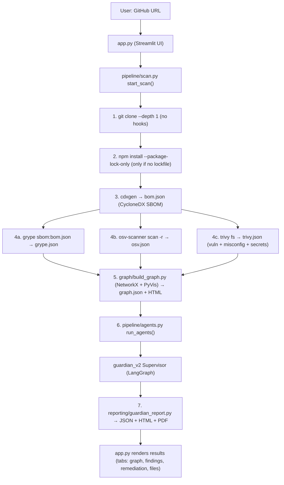
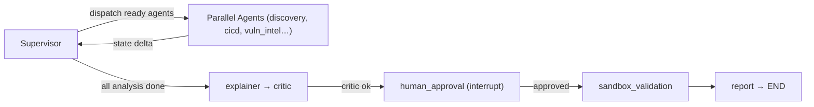

# 🛡️ Software Supply Chain Guardian — Codebase Analysis

> **Project:** Bosch AI Hackathon — Team 31  
> **Goal:** Automated software supply chain security analysis — clone a GitHub repo, build a SBOM, scan it, build a dependency graph, run a multi-agent investigation, and generate a validated security report.

---

## 🗂️ Top-Level Folder Structure

```
Software-Supply-Chain-Guardian_Team-31/
├── app.py                    ← Streamlit web UI (entry point)
├── requirements.txt          ← Python deps (networkx, pyvis, streamlit, langgraph, pydantic…)
├── Makefile                  ← Build/run convenience targets
├── README.md                 ← Full project docs
├── SECURITY-REVIEW.md        ← Security audit notes
├── ssg_analysis.py           ← Standalone analysis script
│
├── pipeline/                 ← Orchestration layer (scan pipeline + remediation)
│   ├── scan.py               ← End-to-end scan pipeline (clone → SBOM → scan → graph → agents)
│   ├── agents.py             ← Bridge: turns scan folder into guardian_v2 inputs
│   └── remediation.py        ← Human-in-the-loop remediation + Docker sandbox
│
├── graph/                    ← Dependency graph builder
│   └── build_graph.py        ← NetworkX + PyVis: graph.json + interactive HTML
│
├── guardian_v2/              ← Multi-agent engine (LangGraph supervisor architecture)
│   ├── run_guardian.py       ← CLI entrypoint for Day 1 / full runs
│   └── guardian_v2/          ← Python package
│       ├── orchestrator.py   ← Supervisor + LangGraph compilation
│       ├── workflow.py       ← Alternative linear DAG workflow
│       ├── state.py          ← Shared GuardianState TypedDict + reducers
│       ├── providers.py      ← LLM provider chain (Anthropic → Groq → Gemini)
│       ├── scoring.py        ← Deterministic risk scoring + SSVC
│       ├── audit.py          ← SHA-256 hash-chained audit trail
│       ├── policy.py         ← Deterministic policy firewall
│       ├── dedup.py          ← Advisory alias deduplication
│       ├── critic.py         ← Evidence critic / claim verifier
│       ├── evidence.py       ← Evidence record creation
│       ├── graph_paths.py    ← Dependency path analysis
│       ├── llm_contract.py   ← LLM prompt building + response parsing
│       ├── safe_version.py   ← Version-safe upgrade planning
│       ├── versions.py       ← Version utilities
│       ├── adapters.py       ← Adapter from v1 agent nodes to v2 state
│       ├── agents/           ← Individual specialist agents
│       ├── sources/          ← Advisory data sources
│       └── tools/            ← HTTP/API tools
│
├── agent/                    ← Earlier 12-node LangGraph scaffold (reference)
│   └── guardian/
│       ├── orchestrator.py
│       ├── agents/           ← 12 specialist agent modules
│       └── core/             ← Gemini, Groq, evidence store, models
│
├── reporting/
│   └── guardian_report.py    ← Final Guardian Report (Pydantic validated → JSON/HTML/PDF)
│
├── policies/                 ← OPA (Rego) policy rules
│   ├── agent.guardian.rego
│   ├── build.guardian.rego
│   └── sandbox.rego
│
├── data/                     ← Scan outputs (not committed except samples)
│   ├── scans/                ← Per-scan folders (created at runtime)
│   ├── sbom/                 ← Sample bom.json
│   ├── scanner_results/      ← Sample grype/osv/trivy JSON
│   └── graphs/               ← Sample graph.json + dependency_graph.html
│
└── .streamlit/config.toml    ← Streamlit theme config
```

---

## 🔄 End-to-End Data Flow



---

## 🤖 Multi-Agent Architecture (guardian_v2)

The core intelligence lives in `guardian_v2/`. It uses a **supervisor pattern on LangGraph** — a supervisor node dispatches agents in parallel turns, each writing state deltas back through a shared `GuardianState`.

### Agent Catalog (in dependency order)

| Agent | Role | Depends On |
|---|---|---|
| `discovery` | Parse SBOM + lockfiles → inventory + graph | — |
| `cicd` | Check Dockerfiles & CI workflows for unsafe patterns | — |
| `vuln_intel` | Pull advisories from PyPI/OSV, npm audit, GHSA, Grype; dedup by alias | `discovery` |
| `reputation` | Registry metadata: versions, yanked, install scripts, integrity | `discovery` |
| `reachability` | AST/regex import analysis — is each package actually used? | `discovery` |
| `exploit_intel` | CISA KEV + FIRST EPSS exploitation signals | `vuln_intel` |
| `anomaly` | Non-CVE risks: typosquats, lockfile tampering, install scripts | `reputation` |
| `scoring` | Deterministic risk score + SSVC decision | `vuln_intel`, `exploit_intel`, `anomaly`, `cicd`, `reachability` |
| `remediation` | Find live-verified safe versions, propose upgrade actions | `scoring`, `reputation` |
| `explainer` | LLM: evidence-cited explanation + next steps | `remediation` |
| `critic` | Verify every LLM claim against evidence store | `explainer` |
| `approval` | **Human-in-the-loop gate** (pauses graph with interrupt()) | `critic` |
| `validation` | Sandbox build + test + live re-scan of approved changes | `approval` |

### Supervisor Loop



**Readiness rule:** an agent runs when all its `requires` agents have produced output the agent hasn't seen yet. The supervisor also accepts **handoff requests** (agent-to-agent through the blackboard) and optionally an **LLM planner** (checked by deterministic guardrails).

---

## 🧩 Key Modules In-Depth

### `pipeline/scan.py` — Scan Pipeline
- Runs entirely in a background thread; Streamlit polls `scan.json`.
- Uses **argument lists** (never shell strings) for all subprocess calls.
- Steps 1–4 run with a **secret-free minimal environment** (`safe_env()`).
- Scanners (Grype, OSV-Scanner, Trivy) run in a `ThreadPoolExecutor(3)` — in **parallel**.
- Records tool versions, Grype DB build date, per-step timing in `scan.json`.
- A scan is only `"complete"` if **every required step** has `status="ok"`.

### `guardian_v2/state.py` — Shared State
All state keys have **LangGraph reducers** to handle parallel writes:
- `components` / `findings` → `merge_keyed_deep` (deep merge by PURL/finding ID)
- `edges` / `raw_advisories` / `approvals` / `audit` → `operator.add` (append)
- `evidence` / `coverage` / `advisories` → `merge_dict` (shallow merge, right wins)

### `guardian_v2/scoring.py` — Risk Scoring
Three **risk classes** scored differently:

| Class | Example Types | Reachability Applies? |
|---|---|---|
| `runtime` | CVE vulnerabilities | ✅ Yes |
| `install` | malicious pkg, install_script, lockfile tampering | ❌ No (runs at install time) |
| `pipeline` | CI/CD, container config | ❌ No |

**Score formula:**
```
score = min(100, (base + exploit) × reachability × scope × exposure × depth)
        + fix_bonus + corroboration_bonus
```
Outputs include an **SSVC decision** (`Track` / `Track*` / `Attend` / `Act`).

### `guardian_v2/audit.py` — Hash-Chained Audit Trail
Every agent action is sealed into a SHA-256 hash chain:
```python
entry["hash"] = sha256(prev_hash_bytes + canonical_json(entry))
```
Parallel agents emit **unsealed events**; the supervisor seals them in a fixed order between supersteps, keeping the chain verifiable even with concurrent agents.

### `guardian_v2/policy.py` — Policy Firewall
Deterministic allow/deny for every tool call:
- **Denied always:** `git.merge`, `git.push_default`, `npm.publish`, `deploy`, etc.
- **Mutations** (`pkg.apply`, `docker.build`, `test.run`) require a `guardian/*` branch **and** Gate 1 approval.
- **PR open** (`git.open_pr`) must be a **draft** and require Gate 2 approval.
- Checks args for secret-like values (via regex).

### `guardian_v2/providers.py` — LLM Provider Chain
Provider chain: **Anthropic → Groq → Gemini** (tries each in order, uses whichever key is set in `.env`).
LLM output **never changes** deterministic values (scores, CVSSs, versions, evidence).

### `pipeline/remediation.py` — Sandboxed Remediation
Human-in-the-loop flow with two approval gates:

```
Gate 1 (human review)
  → policy firewall check
  → apply changes to a COPY of package.json
  → npm install --package-lock-only (metadata only, no code runs)
  → verify target versions present / vulnerable versions gone
  → Docker sandbox: install (network ON, install scripts OFF)
  → Docker sandbox: test (network OFF, read-only rootfs, non-root, capability-dropped)
  → OSV re-scan of new lockfile
Gate 2 (human review of validated changeset)
  → write patch + package-lock.remediated.json + PR_DRAFT.md
  → audit chain appended
  (never pushed or merged — stays human-only)
```

### `reporting/guardian_report.py` — Final Report
Every finding passes **EvidenceValidator** (Pydantic) before appearing:
- Vulnerability IDs must exist in raw scanner output or authoritative API responses.
- Package versions must exist in the SBOM.
- Dependency paths must be real edges in the graph.
- Fixed versions must be reported by a scanner or advisory.
- Secret findings must not carry a secret value.

Rejected findings are **listed in the report**, never silently dropped.  
Outputs: `guardian-report.json`, `guardian-report.html`, `guardian-report.pdf`.

---

## 🗃️ guardian_v2 Sub-Packages

### `agents/` — Specialist Agents

| File | Purpose |
|---|---|
| `base.py` | `Agent` + `AgentResult` dataclasses; `handoff()` helper |
| `discovery.py` | CycloneDX SBOM + npm-lock + pipdeptree → inventory & edges |
| `intel.py` | Multi-source vuln intel: PyPI/OSV, npm audit, GHSA, Grype, Trivy, OSV-Scanner |
| `reputation.py` | npm packument + PyPI JSON → registry metadata |
| `reachability.py` | AST (Python) + regex (JS/TS) import analysis |
| `anomaly.py` | Typosquats, install scripts, lockfile tampering, suspicious updates |
| `cicd.py` | Unpinned Docker FROM, tag-based GitHub Actions, dangerous workflow combos |
| `reasoning.py` | Scoring agent + LLM Explainer agent + Critic agent |
| `remediation.py` | Upgrade planning (live version lookup + co-upgrade resolution) |
| `gate.py` | Human approval interrupt + sandbox validation |
| `report.py` | Write guardian-report.json, .md, SARIF |
| `day1_outputs.py` | Day 1 demo report writer |

### `sources/` — Advisory Data Sources

| File | Source |
|---|---|
| `grype.py` | Parse Grype JSON reports |
| `osv.py` | OSV.dev batch API |
| `ghsa.py` | GitHub Advisory Database (requires `GITHUB_TOKEN`) |
| `kev.py` | CISA Known Exploited Vulnerabilities catalog |
| `scanners.py` | OSV-Scanner + Trivy report parsers |

### `tools/` — HTTP/API Tools

| File | Tool |
|---|---|
| `http.py` | Simple `urllib`-based HTTP client with caching |
| `npm.py` | npm audit API + packument metadata |
| `pypi.py` | PyPI JSON API + OSV advisories |
| `osv.py` | OSV.dev API client |
| `exploit.py` | FIRST EPSS API + CISA KEV |

---

## 🕸️ Earlier `agent/` Scaffold (12-node linear pipeline)

A reference linear LangGraph pipeline (pre-supervisor architecture):

```
Ingestion → DependencyGraph → VulnIntelligence
  → PackageReputation → SupplyChainAnomaly → Container/CI-CD → Reachability
  → RiskScoring → Remediation → EvidenceCritic → Groq/GeminiInference → Report
```

Uses `agent/guardian/core/groq.py`, `gemini.py`, and `evidence_store.py`.  
> Kept as reference — `guardian_v2/` is the active codebase.

---

## 🌐 Streamlit UI (`app.py`)

| Tab | Content |
|---|---|
| **Dependency graph** | Interactive PyVis HTML (embedded iframe) |
| **Findings** | Merged vulnerability/anomaly table from graph.json |
| **Agent report** | Multi-agent assessment, LLM explanations, remediation plans |
| **Remediation** | Gate 1 approve/reject → sandbox validation → Gate 2 → PR artifacts |
| **Repo checks** | Trivy misconfigurations + secrets (values redacted) |
| **Steps & tools** | Per-step status, timing, tool versions, Grype DB date |
| **Files** | Download: SBOM, scanner JSONs, graph, agent reports, PDFs |

The sidebar shows scan history (up to 25 scans).

---

## 🔐 Security Design Principles

| Principle | Implementation |
|---|---|
| **Evidence-first** | Every finding references a hashed evidence record; LLM cannot fabricate scanner output |
| **Never execute untrusted code** | No scripts from cloned repos run; cdxgen uses `--no-install-deps` |
| **Secret isolation** | `safe_env()` strips all API keys from subprocess environments |
| **Human-only merge/publish** | Policy firewall hard-denies merge/push/deploy |
| **Sandboxed remediation** | npm changes tested in Docker with network off, read-only FS, capability-dropped |
| **Tamper-evident audit** | SHA-256 hash chain; parallel agents queue, supervisor seals in fixed order |
| **Honest reporting** | Missing evidence shown as "unavailable"; scan only "complete" if ALL steps pass |

---

## 📦 Key Dependencies

| Package | Purpose |
|---|---|
| `streamlit` | Web UI |
| `langgraph` | Multi-agent supervisor graph |
| `networkx` | Dependency graph (DAG) |
| `pyvis` | Interactive HTML graph (vis-network) |
| `pydantic` | Report finding schema validation |
| `univers` | Ecosystem-aware version range matching |
| `cvss` | CVSS vector → base score |
| `packaging` | Python version comparison |

External tools (installed separately via WinGet/brew/apt):
- `cdxgen` — CycloneDX SBOM generator
- `grype` — Anchore vulnerability scanner
- `osv-scanner` — Google OSV Scanner
- `trivy` — Aqua Security (vuln + misconfig + secrets)
- **Docker Desktop** — required for sandbox validation step

---

## 🗺️ Data Layout Per Scan

```
data/scans/<scan_id>/
├── scan.json                   ← metadata, step status, tool versions
├── sbom/bom.json               ← CycloneDX SBOM
├── scanner_results/
│   ├── grype.json
│   ├── osv.json
│   └── trivy.json
├── graphs/
│   ├── graph.json              ← nodes, edges, merged findings, paths
│   └── dependency_graph.html   ← interactive PyVis graph
├── agents/
│   ├── investigation.json      ← agent conversation + coverage summary
│   ├── guardian-report.json    ← validated findings report
│   ├── guardian-report.md
│   ├── guardian-report.html
│   ├── guardian-report.pdf
│   ├── guardian.sarif          ← SARIF 2.1.0
│   └── audit.jsonl             ← hash-chained agent audit trail
└── remediation/                ← (after remediation tab is used)
    ├── audit.jsonl             ← remediation audit chain
    ├── guardian-remediation.patch
    ├── package-lock.remediated.json
    └── PR_DRAFT.md
```
