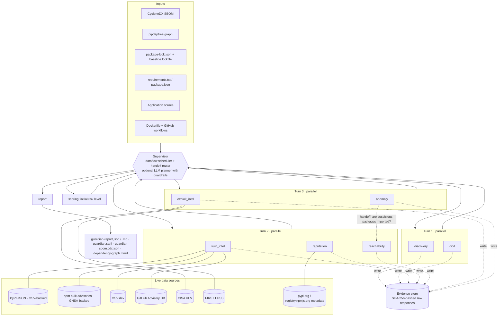

# Software Supply Chain Guardian: Day 1 Architecture
**"Build the Guardian's Eyes": discover the supply chain, detect risks, explain what was found with evidence.**

Day 1 checkpoint: *"Show us what is in the application, what changed, and what appears risky."*

```bash
python run_guardian.py --config demo-app/guardian-day1.json --day1
```

This runs 8 Day 1 agents under a supervisor and stops before remediation, which is Day 2.

---

## 1. Day 1 requirements → what answers them

| Slide 4 requirement | Agent | Output / evidence | Status |
|---|---|---|---|
| **1 Discover:** analyze package manifests and lockfiles | `discovery` | Parses `requirements.txt`, `package.json`, `package-lock.json` v2/v3 | ✅ |
| Identify direct and transitive dependencies | `discovery` | `direct` flag from the manifest or SBOM root; transitive from graph edges | ✅ |
| Capture component names and versions | `discovery` | Inventory keyed by PURL (`pkg:pypi/werkzeug@2.0.1`) | ✅ |
| **2 Supply chain view:** generate or consume an SBOM (CycloneDX or SPDX) | `discovery` consumes, `report` generates | Input: CycloneDX 1.6 from `cyclonedx-py`. Output: `guardian-sbom.cdx.json`, **validated against the CycloneDX 1.6 schema** | ✅ CycloneDX · ⚠ SPDX input not yet parsed |
| Build the dependency graph | `discovery` | Edges with version constraints (`flask → werkzeug >=2.0`); `dependency-graph.mmd` | ✅ |
| Identify where each component originates | `reputation` + `report` | `origin`: registry, download host, source repo, trusted-host flag | ✅ |
| Inspect at least one container image or CI/CD workflow | `cicd` | Dockerfile `FROM` pinning; GitHub Actions pinning, `pull_request_target`, permissions | ✅ Dockerfile + workflow · ⚠ built-image layer scan not yet |
| **3 Detect vulnerabilities:** correlate components with known vulnerabilities | `vuln_intel` | Live multi-source lookup, de-duplicated by alias | ✅ |
| Capture CVE, severity and available fixes | `vuln_intel` + `exploit_intel` | `canonical_id`, aliases, CVSS (when a source provides it), `recommended_fix`, KEV, EPSS | ✅ |
| Trace vulnerable transitive dependencies back to their source | `vuln_intel` (graph paths) | `paths` (root → … → package) and `introduced_by` (the direct dependency to change) | ✅ |
| **4 Detect suspicious changes:** at least one anomaly | `anomaly` | 13 detectors: typosquat, malicious, install script, lockfile tampering, unexpected dependency, suspicious update, integrity mismatch, … | ✅ (Day 1 asks for one) |
| **5 Present evidence:** what was detected, affected component, dependency path, evidence, initial risk level | `scoring` + `report` | Every finding has evidence IDs pointing at hashed raw data, a score, a confidence and an SSVC label | ✅ |

---

## 2. Architecture diagram



---

## 3. Orchestration

The Guardian is not a fixed script. A **supervisor** (LangGraph) decides each turn which agents run. Agents never call each other; they report to the supervisor and can ask it for handoffs.

**Readiness rule:** an agent runs when every agent it depends on has produced output it has not seen yet. Agents that become ready in the same turn run in parallel.

**Handoffs:** an agent can return a request such as `{"to": "reachability", "reason": …, "task": {"focus": [...]}}`. The supervisor dispatches it and holds back anything that depends on the requested agent, so nothing reads stale data.

**Stop condition:** the run ends when no agent has new inputs and no handoff is open.

| Agent | Depends on |
|---|---|
| discovery, cicd | none |
| vuln_intel, reputation, reachability | discovery |
| exploit_intel | vuln_intel |
| anomaly | reputation |
| scoring | vuln_intel, exploit_intel, anomaly, cicd, reachability |

**The actual Day 1 run on the demo app** (from `demo-app/sample-run-day1.log`):

| Turn | Supervisor dispatched | Result |
|---|---|---|
| 1 | discovery ∥ cicd | 16 components (7 direct), 12 edges · 5 container/CI findings |
| 2 | vuln_intel ∥ reputation ∥ reachability | 80 raw advisory records → **44 unique vulnerabilities** on 10 packages · registry flags `lodahs` as a security-holding package · 4 packages imported, 10 used transitively |
| 3 | exploit_intel ∥ anomaly | 37 CVEs checked against KEV (0 listed) · 9 non-CVE findings · **anomaly → reachability handoff** |
| 4 | reachability *(handoff; scoring deferred)* | Suspicious packages imported by source code: none |
| 5 | scoring | 58 findings ranked; #1 MALICIOUS_PACKAGE lodahs = 78.0 (SSVC *Act*) |
| 6 | report | 5 output files |

---

## 4. Inputs

| Input | Example | Produced by |
|---|---|---|
| SBOM | `inputs/sbom.cdx.json` | `cyclonedx-py environment <venv-python>` |
| Python dependency graph | `inputs/pipdeptree.json` | `pipdeptree --python <venv-python> --json` |
| Python manifest | `requirements.txt` | Repository |
| npm lockfile and manifest | `package-lock.json`, `package.json` | Repository |
| Baseline lockfile (for "what changed") | `baseline/package-lock.json` | Previous commit: `git show HEAD~1:package-lock.json` |
| Application source | `src/`, `frontend/` | Repository |
| Container / CI config | `Dockerfile`, `.github/workflows/*.yml` | Repository |
| Policy settings | `internal_namespaces`, `min_release_age_days`, `context.exposure` | `guardian.json` |

All inputs are listed in one config file (`demo-app/guardian-day1.json`). Paths are resolved relative to it.

---

## 5. Agent specifications (Day 1)

Day 1 agents are **fully deterministic**. Every fact comes from a parser, a live API response or a rule, and is stored as evidence. AI is used only optionally in Day 1, as the supervisor's LLM planner (`--llm-planner`), which can only choose among ready agents and is replaced by the deterministic policy if its choice is invalid. LLM explanations and the Critic come in on Day 2.

### 5.1 discovery
| | |
|---|---|
| **Purpose** | One inventory and one graph from every input format |
| **Reads** | CycloneDX `components` + `dependencies`; pipdeptree nodes with `required_version`; npm lockfile `packages`; manifests |
| **Writes** | `components{purl → name, version, ecosystem, direct, scope, sources[], lock{resolved, integrity, hasInstallScript}}`, `edges[{from, to, constraint}]`, `discrepancies[]` |
| **Rules** | PEP 503 name normalization; npm scope encoding in PURLs; `pip`/`setuptools`/`wheel` get scope `environment`; SBOM vs graph mismatches become discrepancies |
| **Evidence** | SHA-256 of every input file |

### 5.2 cicd
| | |
|---|---|
| **Purpose** | Container image and CI/CD pipeline hygiene |
| **Checks** | `FROM` image without an `@sha256:` digest; `uses:` not pinned to a 40-character commit SHA; `pull_request_target` combined with a PR-head checkout; `permissions: write-all` |
| **Evidence** | File path, line number, line text |
| **Why** | The tj-actions/changed-files compromise (CVE-2025-30066) re-pointed tags at a malicious commit |

### 5.3 vuln_intel (multi-source)
| | |
|---|---|
| **Purpose** | Every known advisory for every component, from several sources, merged |
| **Sources (run in parallel)** | PyPI JSON `vulnerabilities` (OSV-backed); npm `/-/npm/v1/security/advisories/bulk` (GHSA-backed, with CVSS); OSV.dev `querybatch` + `vulns/{id}`, with CVSS computed from the vector; GHSA REST (when `GITHUB_TOKEN` is set); Grype report (if supplied) |
| **De-duplication** | Union-find over `id` + `aliases`; canonical ID is CVE, then GHSA, then other; one finding per (issue, component) |
| **Conflicts** | Each source's affected-range verdict, fixed version and severity are kept; disagreements are listed in `source_conflicts` |
| **Version matching** | `univers` / PEP 440 / npm semver ranges. **Never decided by an LLM** |
| **Traceability** | `paths` = every root → … → package chain (bounded BFS); `introduced_by` = the direct dependencies that pull it in |

### 5.4 reputation
| | |
|---|---|
| **Purpose** | Registry metadata: origin and trust signals |
| **Sources** | `pypi.org/pypi/<name>/json`; `registry.npmjs.org/<name>` |
| **Writes** | Published versions (yanked/deprecated), publish time of the locked version, latest version, security-holding flag, registry `dist.integrity`, install scripts, maintainer count, source repo |

### 5.5 reachability
| | |
|---|---|
| **Purpose** | Is each package actually used by the application? |
| **Method** | Python AST imports; JS `require`/`import` scan; graph walk from imported packages |
| **States** | `imported` (file:line evidence) · `used_transitively` · `not_imported` · `not_in_runtime` |
| **Handoff** | Re-runs with a `focus` list when anomaly asks about suspicious packages |
| **Limit** | Import-level, not call-graph. Labelled `method: import analysis` |

### 5.6 exploit_intel
| | |
|---|---|
| **Sources** | CISA KEV (cisagov/kev-data mirror, falling back to cisa.gov); FIRST EPSS |
| **Writes** | `kev`, `kev_record{dateAdded, dueDate, ransomware}`, `epss{score, percentile}` per CVE |

### 5.7 anomaly (suspicious changes)

| Detector | Signal | Base score |
|---|---|---|
| `malicious_package` | Registry replaced the package with a security-holding package | 9.5 |
| `dependency_confusion` | A configured internal namespace exists on the public registry | 9.0 |
| `integrity_mismatch` | Lockfile hash ≠ registry `dist.integrity` | 8.5 |
| `lockfile_tampering` | Integrity or resolved URL changed vs baseline **without a version change** | 8.5 |
| `untrusted_resolved_url` | Lockfile downloads from a host that is not the official registry | 7.5 |
| `typosquat_suspect` | Damerau-Levenshtein ≤ 2 from a popular package name | 7.0 |
| `unpublished_version` | Locked version no longer exists on the registry | 7.0 |
| `suspicious_update` | Locked version published inside the cooling-off window (default 14 days) | 6.0 |
| `install_script` | `preinstall`/`install`/`postinstall`, or lockfile `hasInstallScript` | 5.0 |
| `unexpected_dependency` | New in the lockfile and not in the manifest, or not reachable from any declared dependency | 5.0 |
| `yanked_or_deprecated` | Yanked or deprecated version | 4.0 |
| `dependency_added` | New in the lockfile and declared in the manifest (informational) | 2.0 |
| `environment_only` | Installer tooling, not an application dependency (informational) | 1.0 |

**Correlation:** findings on the same component record each other in `correlated_with`, and each extra independent signal raises the score (+5, up to +15).

### 5.8 scoring (initial risk level)

`score = (base + exploit) × reachability × scope × exposure × depth + fix_bonus + correlation_bonus`, capped at 100. Every term is stored in `score_breakdown`.

| Risk class | Applies to | Reachability factor |
|---|---|---|
| runtime | CVEs | imported 0.9 · transitive 0.8 · unknown 0.7 · not imported 0.3 · not in runtime 0.2 |
| install | malicious, typosquat, install script, tampering, confusion, suspicious update | **1.0**: the code runs during `npm install` / `pip install` whether or not it is imported |
| pipeline | CI/CD and container findings | 1.0: package reachability does not apply |

- **Exploit term:** KEV or an implied-active finding (malicious package) adds 30; PoC-level (tampering, confusion, dangerous workflow) adds 15; otherwise EPSS percentile × 20.
- **Confidence:** High/Medium/Low from source agreement, conflicts, reachability evidence and whether CVSS was available. It is never the LLM's self-assessment.
- **SSVC label** (simplified CISA mapping): Track / Track\* / Attend / Act.

### 5.9 report
Writes the five Day 1 deliverables (§7), plus the full agent conversation trace.

---

## 6. Evidence model

```text
Evidence  { id: "EV-<source>-<sha256[:16]>", kind, source, uri, retrieved_at, sha256, payload }
Finding   { id, type, canonical_id, aliases[], component_purl, paths[[...]], introduced_by[],
            sources[], source_conflicts[], recommended_fix, cvss, kev, epss,
            score, score_breakdown{}, confidence, ssvc{}, reachability_state,
            correlated_with[], evidence_ids[], summary }
Component { purl, name, version, ecosystem, direct, scope, sources[], lock{}, registry{},
            reachability{state, locations[], evidence_ids[]}, origin{} }
```

Every finding's `evidence_ids` resolve to stored raw data: the API response, input file or detector output. The store is append-only per run. This is what makes Day 2's Critic possible: an AI claim that cites no stored evidence is rejected.

---

## 7. Day 1 outputs, with real examples from the demo run

| File | Content |
|---|---|
| `guardian-report.json` | Inventory (with origin and reachability), all findings with evidence, coverage per source, agent trace |
| `guardian-report.md` | Human-readable: top findings, **What changed**, dependency graph, source coverage, agent trace |
| `guardian.sarif` | SARIF 2.1.0 for GitHub code scanning |
| `guardian-sbom.cdx.json` | **Generated CycloneDX 1.6 SBOM + vulnerabilities** (16 components, 17 dependency entries, 44 vulnerabilities), schema-valid |
| `dependency-graph.mmd` | Mermaid graph; vulnerable nodes red, anomalous nodes orange |

### Example 1: vulnerable dependency, traced to its source
```json
{ "canonical_id": "CVE-2023-25577", "aliases": ["GHSA-xg9f-g7g7-2323", "PYSEC-2023-58"],
  "component_purl": "pkg:pypi/werkzeug@2.0.1",
  "paths": [["app", "werkzeug@2.0.1"], ["app", "flask@2.0.1", "werkzeug@2.0.1"]],
  "introduced_by": ["flask@2.0.1", "werkzeug@2.0.1"], "recommended_fix": "2.2.3",
  "reachability_state": "used_transitively", "score": 21.0, "confidence": "Low",
  "evidence_ids": ["EV-pypi-7b21d6280d7e087d"] }
```
Confidence is **Low** for an honest reason: only one source answered in this sandbox, and it supplies no CVSS score, so a labelled default was used. With OSV or GHSA reachable, the score and confidence come from real CVSS and two agreeing sources.

### Example 2: vulnerable transitive dependency
`CVE-2025-50181` on `urllib3@1.26.20`, path `app → requests@2.25.1 → urllib3@1.26.20`, introduced by `requests`. The developer changes `requests`, not `urllib3`.

### Example 3: what changed (baseline lockfile vs current)
- **lockfile_tampering**: `minimist@1.2.5` integrity and resolved URL changed without a version change. It now downloads from `npm-mirror.example-cdn.net` (origin `trusted_host: false`). Score 59.0, SSVC *Attend*, confidence High, corroborated by `integrity_mismatch` and `untrusted_resolved_url`.
- **dependency_added**: `lodahs@1.0.0` is new in the lockfile.
- **suspicious_update**: `certifi@2026.11.20` was published 2.5 days before the scan. This is a real live signal, not seeded.

### Example 4: what appears risky
`MALICIOUS_PACKAGE` on `lodahs@1.0.0`: the npm registry has replaced it with a security-holding package. It is corroborated by `typosquat_suspect` (looks like `lodash`) and `install_script`. Score 78.0, SSVC *Act*, confidence High. The reachability handoff confirmed source code never imports it. That doesn't lower the risk, because install scripts run at install time.

---

## 8. Source coverage in the demo run

| Source | Status in this sandbox | On a normal network |
|---|---|---|
| PyPI JSON (OSV-backed) | ✅ ok | ✅ |
| npm bulk advisories | ✅ ok | ✅ |
| CISA KEV | ✅ ok (1,790 entries) | ✅ |
| pypi.org / npm registry metadata | ✅ ok | ✅ |
| OSV.dev | ❌ blocked by sandbox network | ✅ |
| FIRST EPSS | ❌ blocked by sandbox network | ✅ |
| GHSA | ⏭ skipped: needs `GITHUB_TOKEN` (60 req/h unauthenticated) | ✅ with token |

Coverage is written into every report. A failed source degrades the run instead of failing it.

---

## 9. Day 1 limits (stated in the demo)

- **SPDX input** is not parsed yet. CycloneDX input and output work.
- **Container:** the Dockerfile is inspected, but a built image's layers are not scanned. Adding Syft/Trivy on the built image is the next step.
- **Reachability** is import-level, not call-graph. Labelled as such.
- **Severity:** PyPI's advisory feed has no CVSS. Python findings get real severities when OSV or GHSA is reachable.
- **Detector tuning:** the typosquat list is a built-in popular-package list, and scoring weights are heuristics to calibrate on labelled findings.
- **Maintainer-change detection** needs historical registry snapshots and is not implemented.

---

## 10. Hand-off to Day 2

The Day 1 state is exactly what Day 2 consumes:

`scoring` → `remediation` (live-verified safe versions + resolver) → `explainer` (LLM) → `critic` → `approval` (human, `interrupt()`) → `validation` (sandbox build, tests, re-scan, SBOM diff) → `report`.

Run both days with `python run_guardian.py --config demo-app/guardian.json`.
