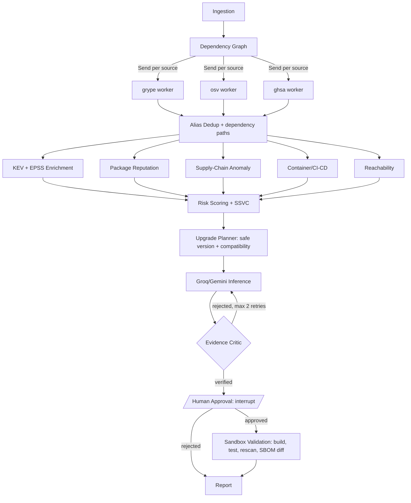
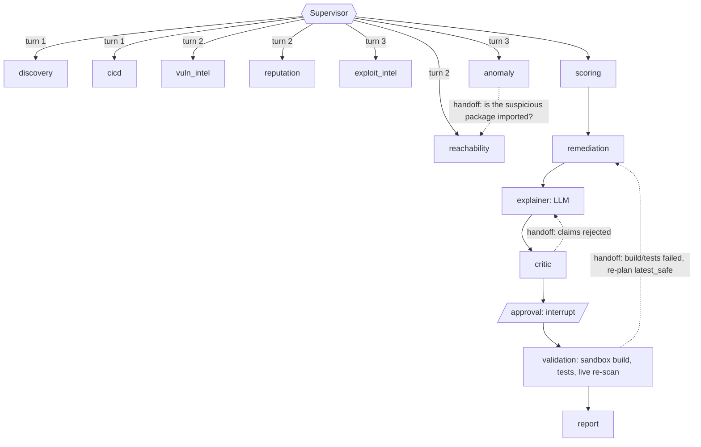

# Software Supply Chain Guardian - Agent Architecture v2

v2 keeps every v1 agent and changes how they are wired: parallel fan-out,
one finding per issue across sources, a deterministic safe-version planner, a
critic that verifies the LLM, and a real human approval gate.

## 1. Workflow



| Change from v1 | Why |
|---|---|
| Sources run as parallel `Send` workers that emit raw records, not findings | One slow or dead source degrades coverage instead of failing the run |
| Findings are created once, in Alias Dedup | v1 created one finding per Grype match, so the same CVE from Grype + OSV was counted twice |
| Five analysis agents run in parallel and join at Risk Scoring | They are independent; the join waits for all five |
| Critic runs after the LLM | In v1 the critic ran before inference, so LLM output was never checked |
| Confidence comes from source agreement, conflicts, reachability tier and match quality | In v1, any finding with an evidence ID became High |
| Upgrade Planner replaces the request_review-only Remediation | Answers "is there a safe version?" and "will it break?" |
| `interrupt()` human gate + checkpointer | Approval is a real pause/resume, recorded with reviewer name |

## 2. State and reducers

`GuardianState` is a `TypedDict` with reducers, because parallel branches
write the same keys in one step:

| Key | Reducer | Meaning |
|---|---|---|
| components, findings, remediation_plans | deep merge by id | Branches enrich the same record without overwriting |
| evidence, coverage, advisories, validation | shallow merge | Keyed, write-once records |
| edges, raw_advisories, approvals | append | Logs |
| llm_claims, critic, critic_attempts, report | overwrite | Only one writer |

**Rule:** a node returns only what it added or changed. v1 nodes return the
whole state, so wrap them with `adapters.adapt(node, to_v1, from_v1)`.
Otherwise the reducers merge the old values a second time.

Deep merge unions lists, so a node cannot remove list items through an update.
Change a status field instead.

## 3. Per-agent contracts

| Agent | Reads | Must write |
|---|---|---|
| Source workers | `purls`, `inputs` | `raw_advisories` in the schema below, `evidence`, `coverage["source:<name>"]` |
| Alias Dedup | raw_advisories, components, edges | `advisories`, vulnerability `findings` with `paths`, `introduced_by` |
| Enrichment | findings | `cve`, `kev`, `kev_record`, `epss` per finding |
| Package Reputation | components | `components[purl]["registry_versions"] = [{"version", "yanked"}]` |
| Reachability | components, source | `components[purl]["reachability"] = {"state", "evidence_ids"}` |
| Anomaly / Container-CI | components, inputs | non-CVE findings with `calibrated_base`, `evidence_ids` |
| Risk Scoring | findings, components | `score`, `score_breakdown`, `confidence`, `ssvc` |
| Upgrade Planner | advisories, registry_versions, edges | `remediation_plans["PLAN::<purl>"]` |

Raw advisory record:

```json
{"source": "ghsa", "id": "GHSA-xg9f-g7g7-2323", "aliases": ["CVE-2023-25577"],
 "purl": "pkg:pypi/werkzeug@2.0.1",
 "ranges": [{"introduced": "0", "fixed": "2.2.3"}],
 "fixed": ["2.2.3"], "cvss": {"vector": "CVSS:3.1/...", "score": 7.5},
 "severity": "high", "summary": "...", "evidence_id": "EV-ghsa-...", "withdrawn": false}
```

`ranges: null` means the source did its own version match (Grype). Sources
that give ranges are re-checked deterministically against the installed
version.

## 4. Multi-source merge rules

- **Identity:** union-find over `id` + `aliases`. The canonical ID is CVE first, then GHSA, then anything else.
- **Affected:** each source's ranges are evaluated deterministically. A finding is dropped only if every source says the version is not affected; disagreement is recorded as a conflict.
- **Fix version:** each source gives its lowest fix above the current version, and the highest of these wins (the conservative choice). Disagreement is recorded.
- **CVSS:** the preference order is GHSA, then CNA, then NVD, then OSV, then scanners. Every source's value is kept in `cvss_by_source`.
- **Withdrawn** advisories are dropped.

## 5. Safe-version planner

- **Candidates:** published, non-yanked, non-prerelease versions above the current one.
- **Target:** the first candidate that clears every advisory per every source. A range-less source with no fix means the planner cannot prove safety, so it falls back to `request_review`.
- **Parent-constraint check:** edge constraints are checked with `univers` for PyPI, npm and Maven. A violation sets `co_upgrade_required`.
- **Fixed fields:** `merge` is always `false` and `requires_human_approval` is always `true`.

A passing constraint check is not proof of compatibility. Flask 2.0.1
declares `Werkzeug>=2.0` but breaks on Werkzeug 3.x, so a major bump is marked
`major_bump_needs_tests` and only the sandbox tests can clear it.

## 6. LLM and critic

**What the LLM receives** (`llm_contract.py`):
- Deterministic facts and evidence IDs for the top 15 findings.
- Advisory text, truncated to 400 characters inside `<untrusted>` tags.
- JSON-only output, where every claim cites evidence IDs.

**What the critic rejects** (`critic.py`):
- Unknown finding IDs.
- Missing evidence, nonexistent evidence, or evidence not linked to the finding.
- CVE, GHSA, PYSEC or MAL IDs that are not aliases of the finding.
- CVSS or KEV values that differ from the deterministic ones.
- Target versions that the planner did not verify.
- Claims of "actively exploited" without KEV evidence.

**Retries and fallback:**
- Rejected claims are sent back to the LLM with the reasons, at most 2 times.
- If the providers are down or retries run out, each finding gets a deterministic `template` explanation in the same schema. The demo works without Groq or Gemini.

## 7. Human gate

`human_approval` calls `interrupt()` with the proposed plans. Resume with:

```python
app.invoke(Command(resume={"decisions": {"PLAN::pkg:pypi/werkzeug@2.0.1": "approve"},
                           "reviewer": "alice"}), config)
```

Use `SqliteSaver` instead of `MemorySaver` so a paused run survives a restart.

## 8. Known limits

- **Reachability is per component, not per advisory.** If Werkzeug is imported, every Werkzeug advisory counts as reachable, including the debugger RCE that needs `debug=True`. The next step is per-advisory symbol rules.
- **SSVC is a simplified mapping,** with these inputs:
  - Exploitation comes only from KEV and a `public_poc` flag.
  - Automatable and technical impact come from the CVSS vector.
- **Scoring weights are heuristics.** Calibrate them on labelled findings.
- **OSV records carry a CVSS vector but no numeric score.** Compute the score with the `cvss` package if OSV is the only source.
- **Accuracy reporting:** the v1 "100% fidelity" figure only shows that Grype output was parsed faithfully. Report detection quality as agreement between sources and recall on labelled fixtures.

## 9. Multi-agent orchestration (supervisor mode)

`guardian_v2/orchestrator.py` runs the same responsibilities as 13 agents
coordinated by a supervisor, instead of a fixed pipeline. `workflow.py` (the
fixed pipeline) is kept for comparison and offline tests.



### How the supervisor decides

Each turn the supervisor picks which agents run, using three inputs:

1. **Dataflow readiness.** Each agent declares the agents it depends on. It is
   ready when all of them have produced output it has not seen yet, so when
   an upstream agent re-runs, everything downstream re-runs automatically.
2. **Handoffs.** Agents never call each other. Each one returns a summary plus
   optional requests (`{"to", "reason", "task"}`), and the supervisor
   dispatches them. Any agent that depends on a requested agent waits a turn
   instead of reading stale data.
3. **Optional LLM planner** (`--llm-planner`). The LLM proposes which agents to
   run and up to two extra investigations. Guardrails accept only agents that
   are ready or requested, keep the human gate exclusive, and fall back to the
   deterministic policy otherwise.

Agents that are ready in the same turn run in parallel. Approval runs alone
and pauses the graph. The run ends when no agent has new inputs and no
handoffs are open, or after 40 turns.

### What each agent pulls (live)

| Agent | Live sources |
|---|---|
| vuln_intel | PyPI JSON (OSV-backed), npm bulk advisories (GHSA-backed), OSV.dev querybatch, GHSA REST (with token), Grype report |
| exploit_intel | CISA KEV (cisagov/kev-data mirror, then cisa.gov), FIRST EPSS |
| reputation | pypi.org project JSON, registry.npmjs.org packuments |
| remediation | Re-scans every candidate version on the registry; reads `requires_dist` and npm `dependencies` for the resolver pass |
| validation | Fresh venv + `pip install` + smoke test; temp dir + `npm install --ignore-scripts` + node smoke; live re-scan of the resulting tree |

### Run it

```bash
python run_guardian.py --config demo-app/guardian.json                 # you approve at the gate
python run_guardian.py --config demo-app/guardian.json --auto-approve  # simulated reviewer
```

## 10. Risk detection coverage

All detectors run inside the orchestration: `anomaly` and `cicd` are
dependencies of `scoring`, so nothing is scored, planned or reported until
they finish.

| Hackathon risk | Detector (agent) | Evidence |
|---|---|---|
| Vulnerable direct / transitive dependency | vuln_intel (PyPI-OSV, npm audit, OSV, GHSA, Grype) | Advisory record + dependency paths |
| Typosquatted or malicious package | anomaly: `malicious_package` (registry security holding), `typosquat_suspect` (edit distance vs popular names) | Registry packument |
| Suspicious package update | anomaly: `suspicious_update` (published inside the cooling-off window, default 14 days) | Registry publish time |
| Unsafe install script | anomaly: `install_script` (lockfile flag or registry scripts) | Lockfile / packument |
| Unexpected lockfile or dependency change | anomaly: `lockfile_tampering` (integrity or URL changed with the same version, vs baseline), `unexpected_dependency` (new or orphaned entry not explained by the manifest), `dependency_added` | Baseline vs current lockfile diff |
| Integrity changes | anomaly: `integrity_mismatch` (lockfile hash vs registry hash), `untrusted_resolved_url` | Registry `dist.integrity` |
| Dependency confusion | anomaly: `dependency_confusion` (configured internal namespaces found on the public registry) | Registry lookup |
| Untrusted container image | cicd: `unpinned_base_image` | Dockerfile line |
| Unpinned or unsafe CI/CD component | cicd: `unpinned_action`, `dangerous_workflow`, `excessive_permissions` | Workflow line |

### Scoring by risk class

| Class | Findings | Reachability factor |
|---|---|---|
| runtime | CVEs | Import-based reachability applies |
| install | malicious, typosquat, install script, tampering, confusion, suspicious update | Always 1.0: the code runs during `npm install` / `pip install` whether or not it is imported |
| pipeline | CI/CD and container findings | 1.0: package reachability does not apply |

**Correlation:** each additional independent signal on the same component adds
5 points, up to 15, and raises confidence.

**Implied exploitation for SSVC:** a malicious package counts as *active*;
tampering, dependency confusion and dangerous workflows count as *PoC*.

**What the reachability handoff is used for:** the anomaly agent asks
reachability whether suspicious packages are imported. The answer no longer
lowers their risk. It feeds remediation instead: "not imported, so removal has
no functional impact" versus "imported: replace it with the intended package".

**Not covered yet:** maintainer-change detection (needs historical registry
snapshots), container image layer scanning (Syft/Trivy on a built image) and
signature/provenance verification (cosign, npm provenance).
