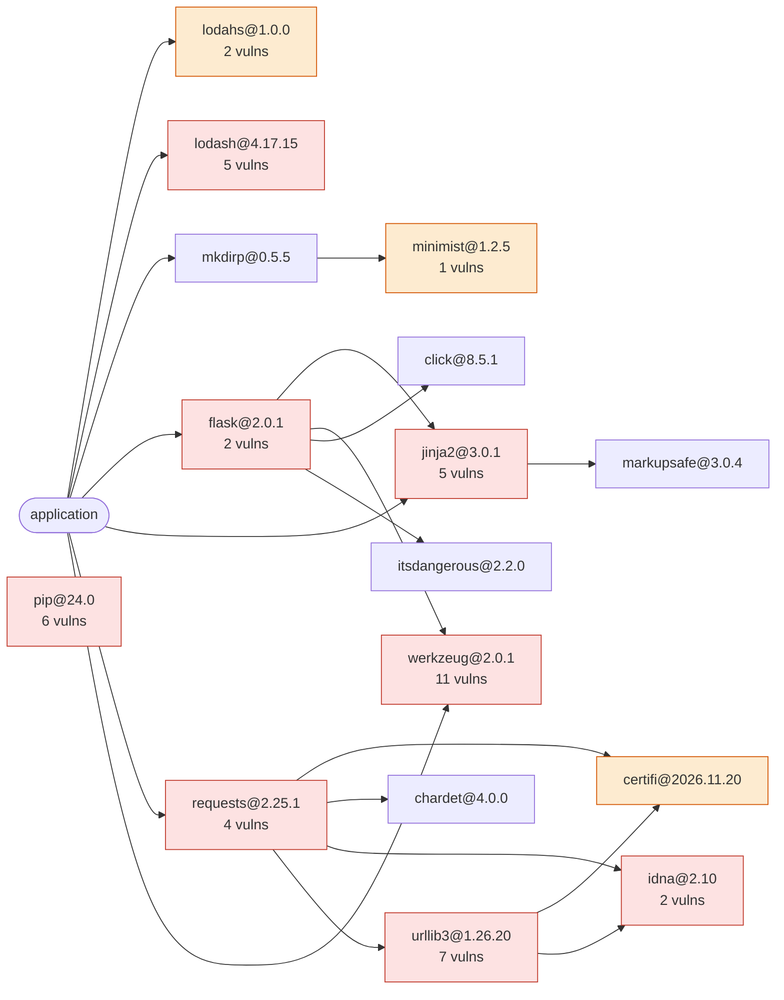

# Guardian Report: run 9dcd6128

16 components, 12 edges, 45 unique vulnerabilities, 14 non-CVE findings.

## Top findings

| Score | Conf | SSVC | Finding | Component | Reachability | Resolution |
|---|---|---|---|---|---|---|
| 78.0 | High | Act | MALICIOUS_PACKAGE | lodahs@1.0.0 | not_imported | open |
| 59.0 | High | Attend | INTEGRITY_MISMATCH | minimist@1.2.5 | used_transitively | open |
| 59.0 | High | Attend | LOCKFILE_TAMPERING | minimist@1.2.5 | used_transitively | open |
| 49.8 | High | Track | CVE-2026-4800 | lodash@4.17.15 | imported | open |
| 48.5 | High | Track | CVE-2021-23337 | lodash@4.17.15 | imported | open |
| 48.3 | High | Track | CVE-2020-8203 | lodash@4.17.15 | imported | open |
| 47.0 | Medium | Attend | DANGEROUS_WORKFLOW | ci.yml | n/a | open |
| 46.5 | Medium | Track | CVE-2021-44906 | minimist@1.2.5 | used_transitively | open |
| 44.6 | High | Track | CVE-2023-30861 | flask@2.0.1 | imported | open |
| 43.3 | Medium | Track | CVE-2024-34069 | werkzeug@2.0.1 | used_transitively | open |
| 42.7 | High | Track | CVE-2023-32681 | requests@2.25.1 | imported | open |
| 42.7 | High | Track | CVE-2025-13465 | lodash@4.17.15 | imported | open |
| 41.1 | High | Track | CVE-2020-28500 | lodash@4.17.15 | imported | open |
| 40.8 | Medium | Track | CVE-2023-25577 | werkzeug@2.0.1 | used_transitively | open |
| 40.4 | Medium | Track | CVE-2023-46136 | werkzeug@2.0.1 | used_transitively | open |
| 40.0 | High | Track | UNTRUSTED_RESOLVED_URL | minimist@1.2.5 | used_transitively | open |
| 39.6 | Medium | Track | CVE-2024-49767 | werkzeug@2.0.1 | used_transitively | open |
| 39.2 | Medium | Track | CVE-2026-21441 | urllib3@1.26.20 | used_transitively | open |
| 38.6 | Medium | Track | CVE-2025-66418 | urllib3@1.26.20 | used_transitively | open |
| 38.6 | Medium | Track | CVE-2025-66471 | urllib3@1.26.20 | used_transitively | open |

## What changed

- **lockfile_tampering**: minimist@1.2.5: integrity/resolved URL changed in the lockfile without a version change.
- **suspicious_update**: certifi@2026.11.20 was published 2.5 days ago (< 14-day cooling-off window).
- **dependency_added**: lodahs@1.0.0 is new in the lockfile.

## Dependency graph

## Remediation plans

| Component | Action | Target | Attempt | Status | Rationale |
|---|---|---|---|---|---|

## Validation

## Source coverage

- discovery: SBOM CycloneDX 1.6: 12 components; pipdeptree: 12 packages; package-lock v3: 4 packages
- reputation: 16 ok, 0 failed
- source:pypi-osv: ok
- source:npm-audit: ok
- source:osv: ok
- source:ghsa: skipped: set GITHUB_TOKEN (unauthenticated limit is 60 req/h)
- source:cisa-kev: ok (1790 entries)
- source:epss: ok (44/44)

## Agent trace

 1. **supervisor** → ['discovery', 'cicd']: policy: ready=['discovery', 'cicd'], handoffs=[]
 1. **cicd** → supervisor: 5 container/CI findings in 2 files
 1. **discovery** → supervisor: 16 components (7 direct), 12 edges; SBOM CycloneDX 1.6: 12 components; pipdeptree: 12 packages; package-lock v3: 4 packages
 2. **supervisor** → ['vuln_intel', 'reputation', 'reachability']: policy: ready=['vuln_intel', 'reputation', 'reachability'], handoffs=[]
 2. **reachability** → supervisor: reachability: {'imported': 4, 'used_transitively': 10, 'not_in_runtime': 1, 'not_imported': 1}
 2. **reputation** → supervisor: registry metadata for 16 packages; security-holding packages: ['pkg:npm/lodahs@1.0.0']
 2. **vuln_intel** → supervisor: 164 raw advisory records from 3/3 sources -> 45 unique vulnerabilities on 10 packages (werkzeug@2.0.1=11, urllib3@1.26.20=7, pip@24.0=6, jinja2@3.0.1=5, lodash@4.17.15=5, requests@2.25.1=4)
 3. **supervisor** → ['exploit_intel', 'anomaly']: policy: ready=['exploit_intel', 'anomaly'], handoffs=[]
 3. **anomaly** → supervisor: 9 non-CVE findings: {'environment_only': 1, 'untrusted_resolved_url': 1, 'integrity_mismatch': 1, 'malicious_package': 1, 'typosquat_suspect': 1, 'install_script': 1, 'suspicious_update': 1, 'lockfile_tampering': 1, 'dependency_added': 1}
 3. **anomaly** → reachability: handoff: suspicious packages found; check whether source code imports them
 3. **exploit_intel** → supervisor: 44 CVEs checked: 0 in CISA KEV, EPSS for 44
 4. **supervisor** → ['reachability']: policy: ready=['scoring'], handoffs=['reachability']
 4. **reachability** → supervisor: reachability: {'imported': 4, 'used_transitively': 10, 'not_in_runtime': 1, 'not_imported': 1}; handoff check on 2 suspicious packages: imported by source = none
 5. **supervisor** → ['scoring']: policy: ready=['scoring'], handoffs=[]
 5. **scoring** → supervisor: scored 59 findings; top: MALICIOUS_PACKAGE on lodahs@1.0.0 = 78.0; INTEGRITY_MISMATCH on minimist@1.2.5 = 59.0; LOCKFILE_TAMPERING on minimist@1.2.5 = 59.0
 6. **supervisor** → report: finish: no agent has new inputs and no handoffs are open