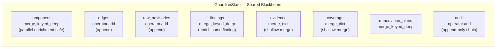
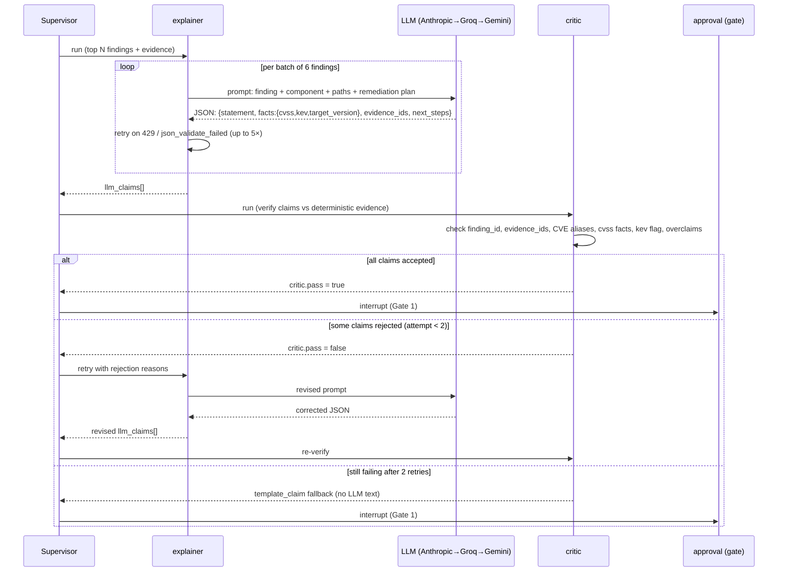
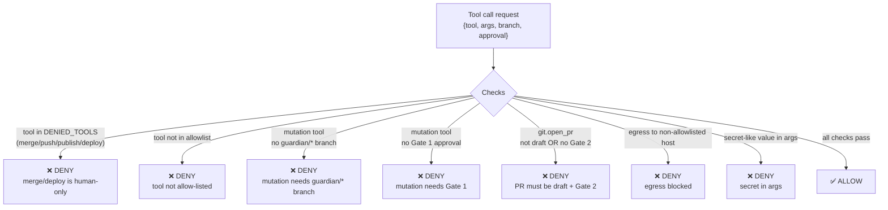

# 🤖 guardian_v2 — Multi-Agent Data Flow

> Every arrow shows what data moves between agents through the shared `GuardianState` blackboard.  
> The **supervisor** orchestrates all agents — no agent calls another directly.

---

## High-Level Agent Pipeline

```mermaid
flowchart TD
    INPUT["📥 Inputs\n(SBOM, lockfile, source dirs,\nDockerfiles, workflows,\nGrype/OSV/Trivy JSONs)"]

    subgraph TURN1["Turn 1 — Parallel (no deps)"]
        DISC["🔍 discovery\n• Parse SBOM components\n• Parse npm-lock edges\n• Parse pipdeptree graph\n• Mark direct deps"]
        CICD["🔧 cicd\n• Scan Dockerfiles\n• Scan GitHub workflows\n• Read Trivy misconfig/secrets"]
    end

    subgraph TURN2["Turn 2 — Parallel (need discovery)"]
        VULN["🛡️ vuln_intel\n• PyPI/OSV API\n• npm audit API\n• OSV.dev batch API\n• GHSA (if token)\n• Grype JSON parser\n• OSV-Scanner parser\n• Trivy vuln parser"]
        REP["📦 reputation\n• npm packument API\n• PyPI JSON API\n• Checks: yanked, install scripts,\n  integrity, security holding,\n  latest vs locked version"]
        REACH["🔎 reachability\n• Python AST import walk\n• JS/TS regex import scan\n• Labels each pkg: reachable /\n  imported / not_imported"]
    end

    subgraph TURN3["Turn 3 — After vuln_intel"]
        EXPLOIT["💥 exploit_intel\n• CISA KEV catalog\n• FIRST EPSS API\n• Tags findings: kev=true,\n  epss score/percentile"]
    end

    subgraph TURN4["Turn 4 — After reputation"]
        ANOMALY["⚠️ anomaly\n• Typosquat OSA-distance check\n• Install-script flags\n• Lockfile integrity check\n• Untrusted resolved URLs\n• Dependency confusion signals\n• Suspicious recent releases\n• Security-holding packages"]
    end

    subgraph DEDUP["Alias De-duplication (auto, after all sources)"]
        DD["🔗 alias_dedup\n• Union-Find over CVE/GHSA/PYSEC IDs\n• One finding per (issue, component)\n• Merges cvss: GHSA > NVD > scanner\n• Records source conflicts\n• Computes dependency paths\n• Sets introduced_by direct dep"]
    end

    subgraph TURN5["Turn 5 — Scoring (joins all 5 analysis branches)"]
        SCORE["📊 scoring\n• base = CVSS/10 × 40  (or calibrated)\n• exploit bonus: KEV+30, PoC+15, EPSS×20\n• × reachability (1.0 → 0.3)\n• × scope (prod/dev/env)\n• × exposure (internet/intranet)\n• × depth (direct vs transitive)\n• + corroboration + fix_bonus\n• SSVC: Track/Track*/Attend/Act\n• confidence: High/Medium/Low"]
    end

    subgraph TURN6["Turn 6 — Remediation planning"]
        REM["🔧 remediation\n• Per finding: pick action\n  (upgrade / remove / pin / fix_config / rotate_secret)\n• Finds minimal safe version (live re-scan)\n• Falls back to latest_safe\n• Resolves co-upgrades via dep edges\n• npm overrides for transitives\n• Marks plan: proposed (needs Gate 1)"]
    end

    subgraph TURN7["Turn 7 — LLM Explanation"]
        EXPLAIN["🧠 explainer (LLM)\n• Top 12 findings by score\n• + worst finding of each type\n• Groq → Gemini → Anthropic chain\n• Builds structured prompt with\n  finding, component, paths, evidence\n• Returns JSON: statement, facts,\n  evidence_ids, next_steps\n• Retries on 429 / json_validate_failed"]
    end

    subgraph TURN8["Turn 8 — Evidence Critic"]
        CRITIC["🔬 critic\n• Checks every LLM claim:\n  - finding_id exists?\n  - evidence_ids linked to finding?\n  - CVE IDs mentioned = known aliases?\n  - cvss/kev facts match deterministic values?\n  - target_version = verified safe?\n  - No overclaims ('actively exploited')\n    without KEV evidence\n• accepted[] / rejected[]\n• If any rejected → retry explainer (max 2×)\n• Then: template fallback"]
    end

    subgraph GATE1["Gate 1 — Human Approval (interrupt)"]
        APPR["👤 approval\n• Shows: component, action, from→to,\n  rationale, CVEs cleared\n• Reviewer ticks approve/reject per plan\n• Sandbox rows = automatable (npm)\n• Manual rows = checklist in draft PR\n• Writes: approved / rejected status"]
    end

    subgraph SANDBOX["Sandbox Validation (if any approved)"]
        VALID["🐳 validation\n• Policy firewall check\n• Apply to COPY of package.json\n• npm install --package-lock-only\n  (no install scripts)\n• Verify versions in new lockfile\n• Docker node:22-slim:\n  install (network ON, scripts OFF)\n• Docker node:22-slim:\n  test (network OFF, read-only FS,\n  all caps dropped, non-root)\n• OSV re-scan of new lockfile\n• sbom_diff: added/removed components\n• Marks plan: validated"]
    end

    subgraph GATE2["Gate 2 — Human Approval of Validated Change"]
        APPR2["👤 approval (gate 2)\n• Shows validated changeset\n• Approve → draft PR artifacts written\n  (patch, lockfile, PR_DRAFT.md)\n• Writes: pr_approved / publish_rejected"]
    end

    subgraph REPORT["Report"]
        RPT["📄 report agent\n• guardian-report.json\n• guardian-report.md\n• guardian.sarif (SARIF 2.1.0)\n• guardian.openvex.json\n• guardian.in-toto.json\n• Findings ranked by score\n• Rejected claims listed\n• Coverage stats"]
    end

    INPUT --> TURN1
    DISC --> TURN2
    CICD --> DEDUP
    VULN --> DEDUP
    VULN --> TURN3
    REP --> TURN4
    REACH --> DEDUP
    EXPLOIT --> DEDUP
    ANOMALY --> DEDUP
    DEDUP --> TURN5
    TURN5 --> TURN6
    TURN6 --> TURN7
    TURN7 --> TURN8
    TURN8 -->|"all accepted"| GATE1
    TURN8 -->|"critic rejects, retries < 2"| TURN7
    GATE1 -->|"any approved"| SANDBOX
    GATE1 -->|"all rejected / analysis-only"| REPORT
    SANDBOX --> GATE2
    GATE2 --> REPORT
```



---

## State Blackboard — What Each Agent Reads & Writes

| Agent | Reads from State | Writes to State |
|---|---|---|
| **discovery** | `inputs.sbom`, `inputs.npm_lock`, `inputs.npm_manifest`, `inputs.python_graph`, `inputs.python_manifest` | `components{purl→{name,version,ecosystem,direct,scope,lock,evidence_ids}}`, `edges[{from,to,constraint,source}]`, `evidence`, `discrepancies[]` |
| **cicd** | `inputs.dockerfiles[]`, `inputs.workflows[]`, `inputs.trivy_report` | `findings{CICD/container findings}`, `evidence` |
| **vuln_intel** | `components`, `inputs.grype_report`, `inputs.osv_scanner_report`, `inputs.trivy_report` | `raw_advisories[]` (one per source per component), `evidence` |
| **reputation** | `components`, `inputs.reputation_focus[]` | `components{purl→{registry_versions,registry:{yanked,install_scripts,integrity,latest…}}}`, `evidence` |
| **reachability** | `components`, `edges`, `inputs.source_dirs[]` | `components{purl→{reachability:{state,files[],evidence_ids}}}`, `evidence` |
| **exploit_intel** | `findings` (vuln type, canonical_id/aliases) | `findings{+kev,+epss:{score,percentile}}` |
| **anomaly** | `components` (with `registry` from reputation), `inputs.npm_lock` | `findings{anomaly findings}`, `evidence` |
| **alias_dedup** (auto node) | `raw_advisories[]`, `components`, `edges` | `advisories{canonical_id::purl→merged}`, `findings{VULN:: findings with paths, introduced_by}` |
| **scoring** | `findings`, `components` (scope, reachability, direct) | `findings{+score, +confidence, +ssvc, +risk_class, +score_breakdown}` |
| **remediation** | `findings`, `components` (ecosystem, version, edges) | `remediation_plans{PLAN::purl→{action,target_version,rationale,evidence_ids,status:proposed}}` |
| **explainer** | `findings` (top 12+), `components`, `evidence`, `remediation_plans` | `llm_claims[]` (statement, facts, evidence_ids, next_steps per finding) |
| **critic** | `llm_claims[]`, `findings`, `evidence`, `remediation_plans` | `critic:{accepted[],rejected[],pass}` |
| **approval** | `remediation_plans` (proposed / validated) | `remediation_plans{+status:approved/rejected/pr_approved}`, `approvals[]` |
| **validation** | `remediation_plans` (approved), `components`, `inputs` | `validation{plan_id→{lockfile_ok,docker_install,docker_test,osv_rescan,sbom_diff,new_findings}}`, `remediation_plans{+status:validated}` |
| **report** | `findings`, `components`, `edges`, `remediation_plans`, `approvals`, `validation`, `critic`, `coverage` | `report{dir,findings[],inventory,coverage}` → writes files |

---

## Shared State Keys & Their Reducers



> **Why reducers matter:** `discovery`, `reputation`, and `reachability` all write to `components` in the same parallel superstep. Without `merge_keyed_deep`, one would overwrite the other. The reducer deep-merges by PURL key — `reputation` adds `registry.*`, `reachability` adds `reachability.*`, without either clobbering the other's fields.

---

## Advisory Alias De-duplication Detail

Multiple sources describe the same vulnerability under different IDs. `dedup.py` runs **Union-Find** over all raw advisories:

```
Grype:  CVE-2022-24999 on lodash@4.17.11
OSV:    GHSA-29mw-wpgm-hmr9 on lodash@4.17.11   (alias: CVE-2022-24999)
npm:    1098765 on lodash@4.17.11                (alias: CVE-2022-24999)

Union-Find groups all three → ONE finding: CVE-2022-24999::pkg:npm/lodash@4.17.11
  canonical_id = CVE-2022-24999 (CVE > GHSA > anything else)
  aliases      = [GHSA-29mw-wpgm-hmr9]
  sources      = [grype, osv, npm-audit]
  cvss         = from GHSA (preferred over NVD/scanner)
  source_conflicts = any disagreements on severity/affected range kept visible
```

---

## Risk Score Breakdown

```
score = min(100,
    (base + exploit_bonus)
    × reachability_factor
    × scope_factor
    × exposure_factor
    × depth_factor
) + fix_bonus + corroboration_bonus
```

| Factor | Values |
|---|---|
| `base` | CVSS base ÷ 10 × 40 (or calibrated: malicious=9.5, typosquat=7.0, install_script=5.0…) |
| `exploit_bonus` | KEV=+30, PoC=+15, EPSS percentile×20 (max of these) |
| `reachability` | reachable=1.0, imported=0.9, used_transitively=0.8, not_imported=0.3, unknown=0.7 |
| `scope` | prod=1.0, dev=0.6, environment=0.1 |
| `exposure` | internet=1.0, intranet=0.8, internal=0.6 |
| `depth` | direct=1.0, transitive=0.9 |
| `fix_bonus` | +5 if safe version exists |
| `corroboration` | +5 per additional corroborating signal (max +15) |

**SSVC decision:** `Track` / `Track*` / `Attend` / `Act` — mapped from exploitation signal × automatable × technical impact × mission criticality.

---

## LLM Explainer Loop (with Critic Retry)



---

## Audit Trail (Hash Chain)

Every agent action is recorded in `audit.jsonl`. Because parallel agents cannot extend the same hash chain simultaneously, they emit **unsealed events** into `audit_pending`; the supervisor seals them in a fixed order between supersteps:

```
Entry N:
  seq        = N
  ts         = ISO-8601 UTC
  actor      = "agent:discovery"
  action     = "agent.run"
  tool       = "discovery"
  args_redacted = {task contents, secrets stripped}
  policy_decision = {allow: true, rule: "agent lifecycle"}
  prev_hash  = hash of entry N-1  (or "000...0" for first)
  hash       = SHA-256(prev_hash_bytes + canonical_json(this_entry_without_hash))
```

The UI verifies the chain and shows `✅ valid` or `❌ broken at seq N`.

---

## Policy Firewall Rules



---

## Data Produced per Scan Run

```
agents/
├── investigation.json        ← messages[], summary, plan_log, critic verdict
├── guardian-report.json      ← Pydantic-validated findings (ranked by score)
├── guardian-report.md        ← Human-readable markdown
├── guardian-report.html      ← HTML with severity badges
├── guardian-report.pdf       ← PDF (via WeasyPrint if available)
├── guardian.sarif            ← SARIF 2.1.0 (CI integration)
├── guardian.openvex.json     ← OpenVEX "not affected" statements
└── guardian.in-toto.json     ← in-toto provenance statement

remediation/
├── audit.jsonl               ← SHA-256 hash-chained audit trail
├── guardian-remediation.patch
├── package-lock.remediated.json
└── PR_DRAFT.md               ← validation evidence + manual checklist
```
